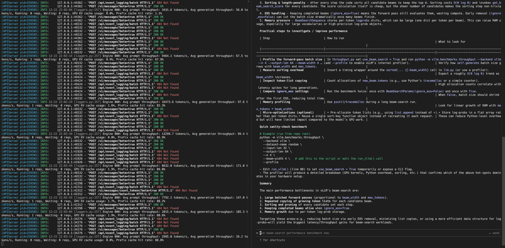

# Claude Code

* https://docs.vllm.ai/en/stable/serving/integrations/claude_code/

[Claude Code](https://code.claude.com/docs/en/quickstart) is Anthropic's official agentic coding tool that lives in your terminal. It can understand your codebase, edit files, run commands, and help you write code more efficiently.
[Claude Code]() 是 Anthropic 官方的智能编程工具, 它驻留在您的终端中. 它可以理解您的代码库、编辑文件、运行命令, 并帮助您更高效地编写代码.

By pointing Claude Code at a vLLM server, you can use your own models as the backend instead of the Anthropic API. This is useful for:
通过将 Claude Code 指向 vLLM 服务器, 您可以使用自己的模型作为后端, 而不是 Anthropic API. 这对于以下情况非常有用:

- Running fully local/private coding assistance
  提供完全本地/私有的编码协助

- Using open-weight models with tool calling capabilities
  使用具有工具调用功能的开放权重模型

- Testing and developing with custom models
  使用自定义模型进行测试和开发

## How It Works
工作原理

vLLM implements the Anthropic Messages API, which is the same API that Claude Code uses to communicate with Anthropic's servers. By setting `ANTHROPIC_BASE_URL` to point at your vLLM server, Claude Code sends its requests to vLLM instead of Anthropic. vLLM then translates these requests to work with your local model and returns responses in the format Claude Code expects.
vLLM 实现了 Anthropic Messages API, 该 API 与 Claude Code 用于与 Anthropic 服务器通信的 API 相同. 通过将 `ANTHROPIC_BASE_URL` 设置为指向您的 vLLM 服务器, Claude Code 会将请求发送到 vLLM 而不是 Anthropic. 然后, vLLM 会将这些请求转换为与您的本地模型兼容的格式, 并以 Claude Code 期望的格式返回响应.

This means any model served by vLLM with proper tool calling support can act as a drop-in replacement for Claude models in Claude Code.
这意味着任何由 vLLM 提供服务且具有适当工具调用支持的模型都可以作为 Claude Code 中 Claude 模型的直接替代品.

## Requirements

Claude Code requires a model with strong tool calling capabilities. The model must support the OpenAI-compatible tool calling API. See [Tool Calling](https://docs.vllm.ai/en/stable/features/tool_calling/) for details on enabling tool calling for your model.
Claude Code 要求模型具备强大的工具调用能力. 该模型必须支持与 OpenAI 兼容的工具调用 API. 有关如何为您的模型启用工具调用功能的详细信息, 请参阅 [工具调用部分]().

## Installation

First, install Claude Code by following the [official installation guide](https://docs.anthropic.com/en/docs/claude-code/getting-started).
首先, 按照[官方安装指南]()安装 Claude Code.

## Starting the vLLM Server

Start vLLM with a tool-calling capable model - here's an example using `openai/gpt-oss-120b`:
使用具备工具调用能力的模型启动 vLLM -- 以下是使用 `openai/gpt-oss-120b` 示例:

```bash
vllm serve openai/gpt-oss-120b \
--served-model-name my-model \
--enable-auto-tool-choice \
--tool-call-parser openai
```

For other models, you'll need to enable tool calling explicitly with `--enable-auto-tool-choice` and the right `--tool-call-parser`. Refer to the [Tool Calling documentation](https://docs.vllm.ai/en/stable/features/tool_calling/) for the correct flags for your model.
对于其他模型, 您需要使用 `--enable-auto-tool-choice` 和正确的 `--tool-call-parser` 参数显式启用工具调用. 请参阅[工具调用文档](), 了解适用于您模型的正确标志.

## Configuring Claude Code

Launch Claude Code with environment variables pointing to your vLLM server:
使用指向 vLLM 服务器的环境变量启动 Claude Code:

```bash
ANTHROPIC_BASE_URL=http://localhost:8000 \
ANTHROPIC_API_KEY=dummy \
ANTHROPIC_AUTH_TOKEN=dummy \
ANTHROPIC_DEFAULT_OPUS_MODEL=my-model \
ANTHROPIC_DEFAULT_SONNET_MODEL=my-model \
ANTHROPIC_DEFAULT_HAIKU_MODEL=my-model \
claude
```

The environment variables:

| Variable                         | Description                                                                                                                      |
| -------------------------------- | -------------------------------------------------------------------------------------------------------------------------------- |
| `ANTHROPIC_BASE_URL`             | Points to your vLLM server (default port is 8000) <br> 指向您的 vLLM 服务器(默认端口为 8000)                                     |
| `ANTHROPIC_API_KEY`              | Can be any value since vLLM doesn't require authentication by default <br> 由于 vLLM 默认情况下不需要身份验证, 因此可以是任何值. |
| `ANTHROPIC_AUTH_TOKEN`           | Is required. Can be any value. <br> 必填项. 可以是任意值.                                                                        |
| `ANTHROPIC_DEFAULT_OPUS_MODEL`   | Model name for Opus-tier requests <br> Opus 层请求的模型名称                                                                     |
| `ANTHROPIC_DEFAULT_SONNET_MODEL` | Model name for Sonnet-tier requests <br> Sonnet 层请求的模型名称                                                                 |
| `ANTHROPIC_DEFAULT_HAIKU_MODEL`  | Model name for Haiku-tier requests <br> Haiku 层级请求的模型名称                                                                 |

> Tip
>
> You can add these environment variables to your shell profile (e.g., `.bashrc`, `.zshrc`), Claude Code configuration file (`~/.claude/settings.json`), or create a wrapper script for convenience.
> 您可以将这些环境变量添加到您的 shell 配置文件(例如 `.bashrc` 、 `.zshrc`)、Claude Code 配置文件( `~/.claude/settings.json` )中, 或者为了方便起见, 创建一个包装脚本.
>

> Warning
>
> Claude Code recently started injecting a per-request hash in the system prompt, which can defeat [prefix caching](https://docs.vllm.ai/en/stable/design/prefix_caching/) because the prompt changes on every request, causing greatly reduced performance. This is addressed automatically in vLLM versions > 0.17.1 but for older versions `"CLAUDE_CODE_ATTRIBUTION_HEADER": "0"` should be added to the `"env"` section of `~/.claude/settings.json` (see this [blog post](https://unsloth.ai/docs/basics/claude-code#fixing-90-slower-inference-in-claude-code) from Unsloth).
> Claude Code 最近开始在系统提示符中注入每个请求的哈希值, 这会破坏[前缀缓存](), 因为提示符每次请求都会改变, 从而导致性能大幅下降. vLLM 版本 0.17.1 及更高版本已自动解决此问题, 但对于旧版本, 应在 `~/.claude/settings.json` 的 `"env"` 部分添加 `"CLAUDE_CODE_ATTRIBUTION_HEADER": "0"` (参见 Unsloth 的这篇[博文]()).

## Testing the Setup

Once Claude Code launches, try a simple prompt to verify the connection:
Claude Code 启动后, 尝试一个简单的提示来验证连接:



If the model responds correctly, your setup is working. You can now use Claude Code with your vLLM-served model for coding tasks.
如果模型响应正确, 则说明您的设置已成功. 现在您可以使用 Claude Code 和由 vLLM 提供服务的模型来执行编码任务.

## Troubleshooting
故障排除

`Connection refused`: Ensure vLLM is running and accessible at the specified URL. Check that the port matches.
连接被拒绝: 请确保 vLLM 正在运行且可通过指定的 URL 访问. 检查端口是否匹配.

`Tool calls not working`: Verify that your model supports tool calling and that you've enabled it with the correct `--tool-call-parser` flag. See [Tool Calling](https://docs.vllm.ai/en/stable/features/tool_calling/).
工具调用不起作用: 请确认您的模型支持工具调用, 并且您已使用正确的 `--tool-call-parser` 标志启用它. 请参阅 [工具调用部分]().

`Model not found`: Ensure the `--served-model-name` matches the model names in your environment variables. You cannot use model names with `/` in them, such as `openai/gpt-oss-120b` directly from Huggingface, so beware of that limitation with Claude Code.
未找到模型: 请确保 `--served-model-name` 与环境变量中的模型名称匹配. 您不能使用包含斜杠 `/` 的模型名称, 例如直接从 Huggingface 使用 `openai/gpt-oss-120b`, 因此在使用 Claude Code 时请注意此限制.


```bash
################### gpt-oss-20b ###################
modelscope download --model openai-mirror/gpt-oss-20b --local_dir /data/model/openai-mirror/gpt-oss-20b/

docker run -ti --rm \
--entrypoint /usr/bin/env \
--security-opt seccomp=unconfined \
--gpus '"device=6, 7"' \
-v /data/model:/model \
-p 0.0.0.0:8090:8000 \
--name vllm-server \
vllm/vllm-openai:v0.22.0-cu129-ubuntu2404 bash

export VLLM_LOGGING_LEVEL=DEBUG
export VLLM_DEBUG_LOG_API_SERVER_RESPONSE=TRUE
export TORCH_SHOW_CPP_STACKTRACES=1

export VLLM_TRACE_FUNCTION=1
unset VLLM_TRACE_FUNCTION

export CUDA_LAUNCH_BLOCKING=1
unset CUDA_LAUNCH_BLOCKING

export NCCL_DEBUG=TRACE
unset NCCL_DEBUG

export NCCL_DEBUG_SUBSYS=INIT,COLL,ENV,ALLOC
unset NCCL_DEBUG_SUBSYS

export TRITON_DEBUG=1
unset TRITON_DEBUG

export TRITON_PRINT_AUTOTUNING=1
unset TRITON_PRINT_AUTOTUNING

export TORCH_DISTRIBUTED_DEBUG=DETAIL
unset TORCH_DISTRIBUTED_DEBUG

vllm serve \
/model/gpt-oss-20b \
--served-model-name gpt-oss-20b \
--trust-remote-code \
--use-tqdm-on-load \
--host 0.0.0.0 \
--port 8000 \
--api-key my_secret_token_123 my_secret_token_456 \
--enable-log-requests \
--no-disable-uvicorn-access-log \
--uvicorn-log-level debug \
--aggregate-engine-logging \
--enable-logging-iteration-details \
--log-error-stack \
--cudagraph-metrics \
--kv-cache-metrics \
--enable-mfu-metrics \
--enable-prompt-tokens-details \
--enable-tokenizer-info-endpoint \
--enable-force-include-usage \
--shutdown-timeout 30 \
--enable-auto-tool-choice \
--tool-call-parser openai \
--tensor-parallel-size 2

################### gpt-oss-120b ###################
modelscope download --model openai-mirror/gpt-oss-120b --local_dir /data/model/openai-mirror/gpt-oss-120b/

docker run -ti --rm \
--entrypoint /usr/bin/env \
--security-opt seccomp=unconfined \
--gpus '"device=4, 5, 6, 7"' \
-v /data/model:/model \
-p 0.0.0.0:8090:8000 \
--name vllm-server \
vllm/vllm-openai:v0.22.0-cu129-ubuntu2404 bash

export VLLM_LOGGING_LEVEL=DEBUG
export VLLM_DEBUG_LOG_API_SERVER_RESPONSE=TRUE
export TORCH_SHOW_CPP_STACKTRACES=1

export VLLM_TRACE_FUNCTION=1
unset VLLM_TRACE_FUNCTION

export CUDA_LAUNCH_BLOCKING=1
unset CUDA_LAUNCH_BLOCKING

export NCCL_DEBUG=TRACE
unset NCCL_DEBUG

export NCCL_DEBUG_SUBSYS=INIT,COLL,ENV,ALLOC
unset NCCL_DEBUG_SUBSYS

export TRITON_DEBUG=1
unset TRITON_DEBUG

export TRITON_PRINT_AUTOTUNING=1
unset TRITON_PRINT_AUTOTUNING

export TORCH_DISTRIBUTED_DEBUG=DETAIL
unset TORCH_DISTRIBUTED_DEBUG

vllm serve \
/model/gpt-oss-120b \
--served-model-name gpt-oss-120b \
--trust-remote-code \
--use-tqdm-on-load \
--host 0.0.0.0 \
--port 8000 \
--api-key my_secret_token_123 my_secret_token_456 \
--enable-log-requests \
--no-disable-uvicorn-access-log \
--uvicorn-log-level debug \
--aggregate-engine-logging \
--enable-logging-iteration-details \
--log-error-stack \
--cudagraph-metrics \
--kv-cache-metrics \
--enable-mfu-metrics \
--enable-prompt-tokens-details \
--enable-tokenizer-info-endpoint \
--enable-force-include-usage \
--shutdown-timeout 30 \
--enable-auto-tool-choice \
--tool-call-parser openai \
--tensor-parallel-size 4

################### gemma-4-31B-it ###################
modelscope download --model google/gemma-4-31B-it --local_dir /data/model/google/gemma-4-31B-it/

docker run -ti --rm \
--entrypoint /usr/bin/env \
--security-opt seccomp=unconfined \
--gpus '"device=6, 7"' \
-v /data/model:/model \
-p 0.0.0.0:8090:8000 \
--name vllm-server \
vllm/vllm-openai:v0.22.0-cu129-ubuntu2404 bash

export VLLM_LOGGING_LEVEL=DEBUG
export VLLM_DEBUG_LOG_API_SERVER_RESPONSE=TRUE
export TORCH_SHOW_CPP_STACKTRACES=1

export VLLM_TRACE_FUNCTION=1
unset VLLM_TRACE_FUNCTION

export CUDA_LAUNCH_BLOCKING=1
unset CUDA_LAUNCH_BLOCKING

export NCCL_DEBUG=TRACE
unset NCCL_DEBUG

export NCCL_DEBUG_SUBSYS=INIT,COLL,ENV,ALLOC
unset NCCL_DEBUG_SUBSYS

export TRITON_DEBUG=1
unset TRITON_DEBUG

export TRITON_PRINT_AUTOTUNING=1
unset TRITON_PRINT_AUTOTUNING

export TORCH_DISTRIBUTED_DEBUG=DETAIL
unset TORCH_DISTRIBUTED_DEBUG

vllm serve \
/model/gemma-4-31B-it \
--served-model-name gemma-4-31B-it \
--trust-remote-code \
--use-tqdm-on-load \
--host 0.0.0.0 \
--port 8000 \
--api-key my_secret_token_123 my_secret_token_456 \
--enable-log-requests \
--no-disable-uvicorn-access-log \
--uvicorn-log-level debug \
--aggregate-engine-logging \
--enable-logging-iteration-details \
--log-error-stack \
--cudagraph-metrics \
--kv-cache-metrics \
--enable-mfu-metrics \
--enable-prompt-tokens-details \
--enable-tokenizer-info-endpoint \
--enable-force-include-usage \
--shutdown-timeout 30 \
--enable-auto-tool-choice \
--tool-call-parser gemma4 \
--tensor-parallel-size 2 \
--max-num-batched-tokens 8192

```
